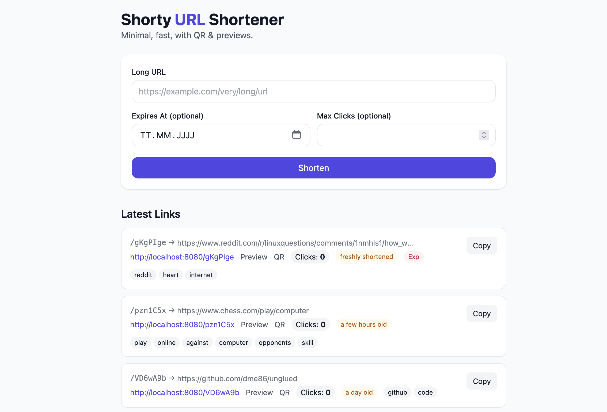

# go shorty

<p align="center">
  
</p>

A fast, production-ready URL shortener written in Go.

**Highlights**
- PostgreSQL storage with migrations (via `goose`)
- OAuth-protected UI/API (OpenID Connect providers)
- Multi-tenant data isolation via `tenant_id`
- Bot-aware **Preview** pages (Slack/Twitter/Discord/etc.) with Open Graph meta
- **QR codes** (PNG) for every link
- **Tags**: inferred from host/path/query and OG metadata
- **Deduplication**: same long URL → reuse existing active short link
- **Max Clicks** & **Expires At** (date-only in UI); **Exp** badge with tooltip
- **Age** badge (“freshly shortened”, “a few days old”, …)
- **/metrics** for Prometheus, **/healthz** for health checks

## Capacity (Shortcodes)

Default code length: **7 Base62 characters** (`a-zA-Z0-9`).  
Theoretical space: `62^7 = 3,521,614,606,208` unique short links (~3.52 trillion).

> Collisions are extremely unlikely; in addition the database enforces uniqueness.

---

## Quickstart

Requirements
- Go ≥ 1.21
- Docker (for local Postgres)
- `goose` (optional; the Makefile can install it)
- Node.js 20+ and npm (for reproducible frontend builds with Vite)

```bash
# 1) Start Postgres via Docker and wait until ready
make db-up

# 2) Install goose (if not yet installed)
make goose-install

# 3) Apply database migrations
make migrate-up

# 4) Build the frontend and run the app (npm ci runs when needed)
make run

# Open the UI
open http://localhost:8080
```

Frontend workflow (Vite + Tailwind + TypeScript):

The generated JavaScript/CSS and `package-lock.json` are committed, so a plain `go build ./cmd/server` embeds working assets even without Node.js. `make run` and `make build` regenerate those assets first using the locked dependencies. CI checks that the committed bundle matches the source.

```bash
# install frontend deps once
make fe-install

# start frontend dev server (HMR)
make fe-dev

# build frontend assets into web/static/dist
make fe-build
```

Frontend source files now live in `web/frontend/src`:
- `main.ts` bootstraps the app
- `app.ts` contains UI behavior
- `styles.css` contains Tailwind/CSS layers

Live frontend development:

```bash
# Terminal 1: backend
make run

# Terminal 2: frontend HMR
make fe-dev
```

Then open the Vite URL printed in terminal (typically `http://localhost:5173`).
UI changes in `web/frontend/src/*` reload instantly via HMR.
Template changes in `web/templates/*` require a normal browser refresh.

Production/static asset flow:

```bash
# Install locked frontend dependencies, build the actual bundle, and embed it
make build

# Run the standalone executable (serves /static/dist/assets/*)
./bin/shorty
```

After changing `web/frontend/src/`, run `make fe-build` and commit the updated `web/static/dist/assets/main.js` and `main.css` together with the source. CI rejects stale or placeholder bundles.

**Endpoints**

-   UI: `GET /`
-   Resolve: `GET /{code}` → 302 redirect to long URL (unless a bot)
-   Preview page: `GET /preview/{code}`
-   QR: `GET /qr/{code}` (public, rate-limited, active links only); legacy tenant-scoped `GET /api/links/{code}/qr.png` remains authenticated
-   Health: `GET /healthz`
-   Prometheus metrics: `GET /metrics`

## Configuration

Environment variables:

-   `BASE_URL` – public base URL, e.g. `http://localhost:8080` or `https://sho.rt`
-   `DATABASE_URL` – Postgres DSN used by the server
-   `DB_URL` – Postgres DSN used by `make`/`goose`
-   `SESSION_SECRET` – random secret used to sign auth session cookies
-   `OAUTH_CLIENT_ID` – OAuth client id
-   `OAUTH_CLIENT_SECRET` – OAuth client secret
-   `OAUTH_AUTH_URL` – provider authorize endpoint
-   `OAUTH_TOKEN_URL` – provider token endpoint
-   `OAUTH_USERINFO_URL` – provider userinfo endpoint (must return `sub`; when supplying `email`, it must also return `email_verified: true`)
-   `OAUTH_REDIRECT_URL` – callback URL, e.g. `http://localhost:8080/auth/callback`
-   `OAUTH_SCOPES` – comma-separated scopes (default `openid,profile,email`)
-   `OAUTH_ALLOWED_DOMAINS` – optional comma-separated email domains (e.g. `example.com,example.org`)
-   `RATE_LIMIT_RPS` – API rate limit refill rate per IP (default `5`)
-   `RATE_LIMIT_BURST` – API burst size per IP (default `20`)
-   `PUBLIC_RATE_LIMIT_RPS` / `PUBLIC_RATE_LIMIT_BURST` – per-IP limits for public redirect/preview requests (default `20` / `60`); excess requests receive HTTP 429
-   `METRICS_TOKEN` – bearer token required for `/metrics`; empty disables the endpoint with HTTP 404
-   `METADATA_WORKERS` / `METADATA_QUEUE_SIZE` – concurrent metadata fetches / waiting jobs (default `4` / `64`)
-   `CLICK_RETENTION_DAYS` / `CLICK_CLEANUP_BATCH` – how long raw click events are retained (default 90 days) and incremental cleanup batch size (default 5000, max 10000). Old events are pruned at startup and hourly.
-   `TRUST_PROXY_HEADERS` – trust `X-Forwarded-For` for client IP (enable **only** when requests pass through a trusted reverse proxy that overwrites incoming forwarded headers)

### OAuth protection

-   UI `/` and `/api/*` are protected by OAuth login.
-   `/api/*` additionally uses per-user rate limiting (OAuth identity), with IP fallback.
-   Public routes remain public: `/{code}`, `/preview/{code}`, `/healthz`, `/static/*`; redirects/previews have a separate per-IP rate limit.
-   `/metrics` requires `Authorization: Bearer <METRICS_TOKEN>`. With no `METRICS_TOKEN`, it returns 404. Configure a Prometheus scrape secret.
-   Creating a link is limited to 16 KiB of JSON. Metadata scraping accepts at most 2 MiB of HTML and uses a fixed-size worker pool with a bounded queue; overflow skips optional metadata, not link creation.
-   OAuth email identities require `email_verified: true` and a stable `sub`. Providers without email can use `sub` identities only if `OAUTH_ALLOWED_DOMAINS` is unset. **Existing login sessions are invalidated by the v3 cookie format, so users must sign in again.**
-   Login flow endpoints: `/auth/login`, `/auth/callback`, `/auth/logout`.

### Multi-tenancy

-   What multi-tenant means here: multiple organizations/teams can use the same running app and database, while API-level reads/writes are isolated per tenant.
-   API data access is tenant-scoped (`links`, `stats`, `dedupe`, `tags`, QR lookup).
-   **Canonical tenant IDs are injective and typed:** a verified email like `alice@a.b.com` maps to `domain:a.b.com`, but `bob@a-b.com` maps to `domain:a-b.com` (not the same tenant). Internationalized domains use their canonical IDNA ASCII form.
    -   Verified email identities share the domain's tenant, e.g. `alice@example.com` and `bob@example.com` both use `domain:example.com`.
    -   Email-less OAuth subjects have their own namespace, `subject:<base64url-of-opaque-sub>`, and cannot collide with email domains; subject case is preserved.
-   Public short-code routes (`/{code}`, `/preview/{code}`) remain globally resolvable by code.
-   **Upgrade/migration:** Earlier versions stored *ambiguous* dash-slug tenant IDs. There is no safe automatic ownership inference: `a-b-com` might have been used by both `a.b.com` and `a-b.com`. Existing rows are intentionally left unchanged and remain publicly resolvable, but are not exposed through the authenticated API until an operator verifies ownership and assigns a canonical tenant.
    1. Back up the database, deploy the new code, and apply `make migrate-up` (migration `0005_tenant_rekey.sql` enables atomic per-link updates).
    2. Inspect each existing link's owner; if a legacy tenant was shared by different domains, manually determine the actual owner for **each link**, not just the old slug.
    3. Rekey only verified links using `psql "$DATABASE_URL" -v ON_ERROR_STOP=1 -v code=Ab12Cde -v legacy_tenant=a-b-com -v new_tenant=domain:a.b.com -f scripts/rekey-link.sql`. The script updates `links` and `clicks` together inside a transaction.
    4. Review remaining legacy rows with `SELECT tenant_id, count(*) FROM links WHERE tenant_id NOT LIKE 'domain:%' AND tenant_id NOT LIKE 'subject:%' GROUP BY tenant_id;`. Do not automatically claim unresolved records.
    5. All **v2 login sessions** are invalidated; users need to sign in again.
-   The previous migration `0004_multitenancy.sql` added `tenant_id` to `links` and `clicks`.

## API Overview

### Create a short link

```bash
POST /api/links
Content-Type: application/json

{
  "url": "https://example.com/path?q=abc",
  "expires_at": "2025-12-31T22:59:59Z",  // optional; UI sends end-of-day ISO
  "max_clicks": 100                      // optional
}
```

Response:

```json
{
  "code": "Ab12Cde",
  "short_url": "http://localhost:8080/Ab12Cde",
  "preview_url": "http://localhost:8080/preview/Ab12Cde",
  "qr_url": "http://localhost:8080/qr/Ab12Cde"
}
```

**Deduplication:** An existing **active** link is returned only when the exact URL, `expires_at`, and `max_clicks` are identical (including whether optional limits are unset). A different limit produces a separate short code. Shortcode uniqueness is enforced by PostgreSQL; rare collisions are retried up to 10 times. URLs must be valid absolute HTTP(S) addresses of at most 2048 bytes.

### List links

```bash
GET /api/links
GET /api/links?tag=steam
```

Returns latest **active** links with `tags`, `created_at`, `click_count`, `expires_at`.

### Resolve

```bash
GET /{code}   → 302 redirect to the long URL
```

User agents that look like bots (Slack/Twitter/Discord/…) get the Preview page to allow rich unfurls; real browsers are redirected. Click counting is **atomic** and respects `expires_at`/`max_clicks`.

### QR

```bash
GET /qr/{code}
```

Returns a 256px PNG (the UI shows an inline modal with download). The public `/qr/{code}` endpoint supports anonymous preview visitors for active, non-expired, non-exhausted links and shares the public request rate limit. The original authenticated API endpoint is retained for compatibility.

### Stats

```bash
GET /api/links/{code}/stats
```

Returns aggregated analytics:
- `click_count` lifetime clicks, never reduced by retention
- `clicks_per_day` time series (`YYYY-MM-DD`) from retained click events
- `top_referrers` top referrer hosts from retained click events
- `user_agent_mix` grouped user-agent classes (`bot`, `mobile`, `desktop`, `unknown`) from retained click events

**Retention:** Raw `clicks` rows older than `CLICK_RETENTION_DAYS` (default 90) are deleted in small transactions on server startup and hourly. The `links.click_count` lifetime counter and `max_clicks` enforcement remain intact. Breakdown statistics only cover the retained window; historical daily/referrer/UA breakdowns older than the configured window will be removed. Apply database migration `0006_clicks_retention.sql` before deploying.

## Observability

-   **/healthz** → `200 ok` if DB is reachable (500ms timeout), otherwise `500 db=down`
-   **/metrics** (Prometheus):
    -   `shorty_links_created_total` (counter)
    -   `shorty_resolve_redirects_total` (counter)
    -   `shorty_links_total` (gauge; `COUNT(*)`)
    -   `shorty_links_active` (gauge; active = not expired & not maxed)
    -   `shorty_tags_distinct_total` (gauge; `COUNT(DISTINCT UNNEST(tags))`)
    -   `shorty_clicks_sum` (gauge; `SUM(click_count)`)
    -   `shorty_metrics_collect_errors_total` (counter; DB errors during metric collection)
        

Prometheus scrape example:

```yaml
scrape_configs:
  - job_name: shorty
    static_configs:
      - targets: ['localhost:8080']
    authorization:
      type: Bearer
      credentials_file: /etc/prometheus/secrets/shorty_metrics_token
```

The bearer-token file should contain the same value as `METRICS_TOKEN` and be mounted as a secret; do not commit the token to Git.

## Security & Scope

-   OAuth login protects UI and API endpoints
-   Per-user API rate limiting with IP fallback
-   Tenant data isolation at API/storage level via `tenant_id`
-   Custom aliases disabled by design
-   Tag inference is deterministic (host, then path/query, then metadata keywords; first 8 unique tags) and can be extended per domain
-   Deduplication is by **exact URL** (query differences → distinct targets)

## Screenshot

<p align="center">
  
</p>
